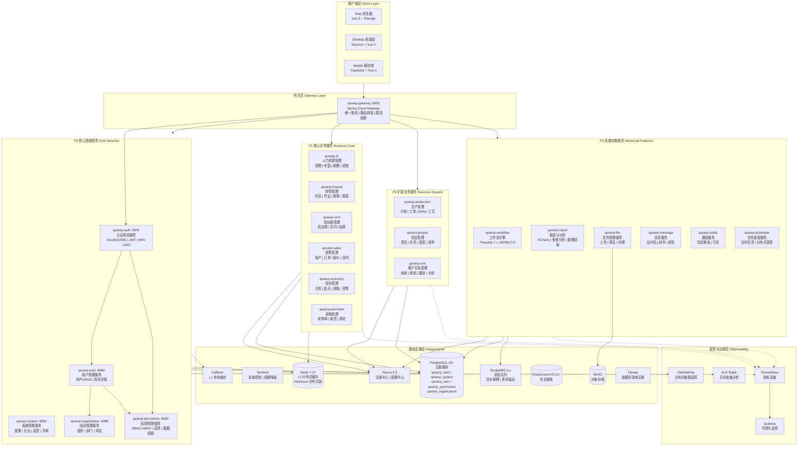
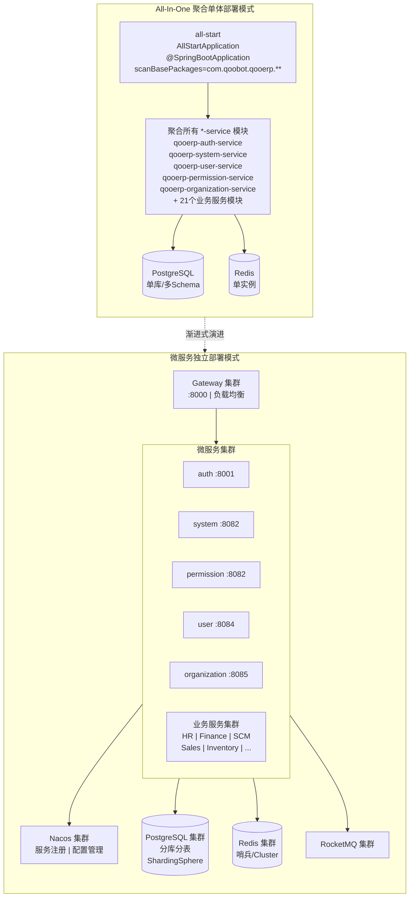
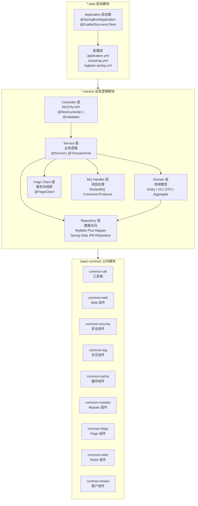
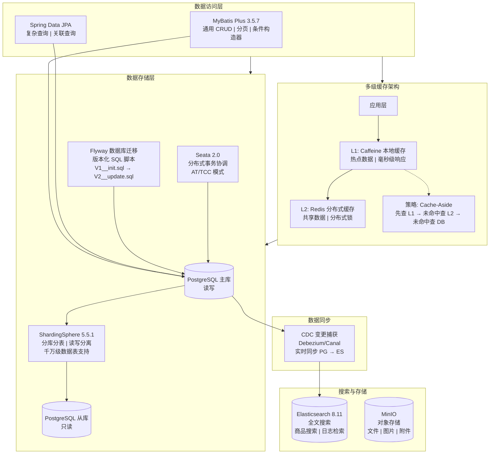
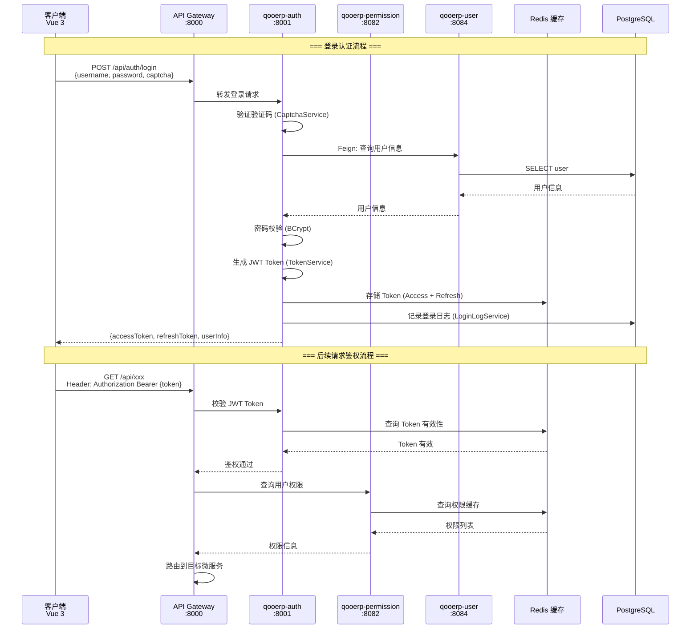
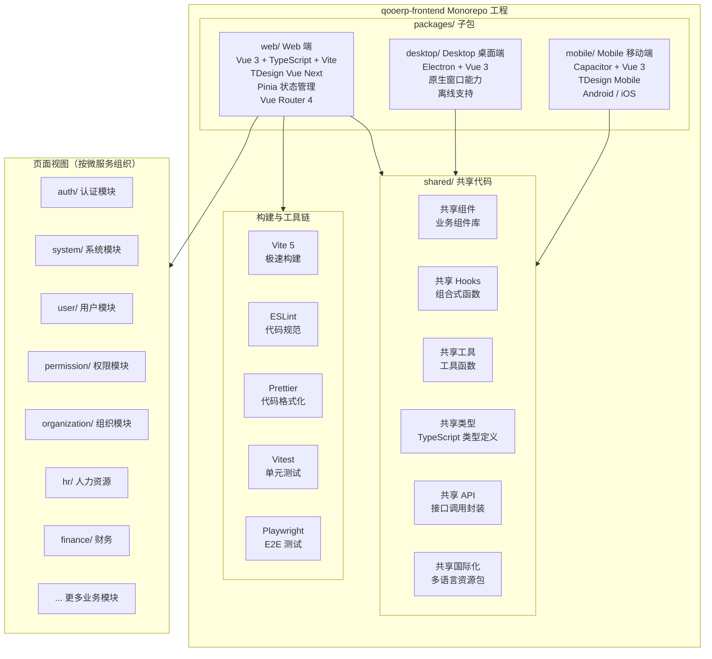
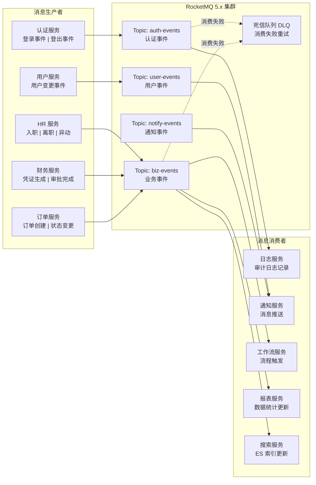
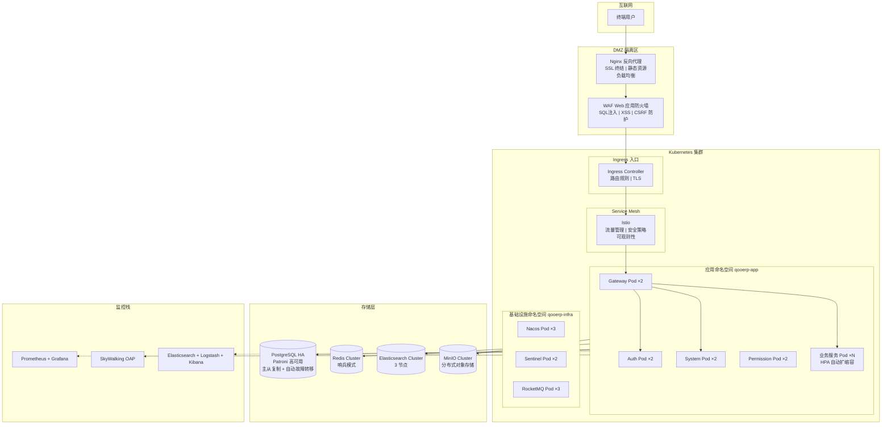
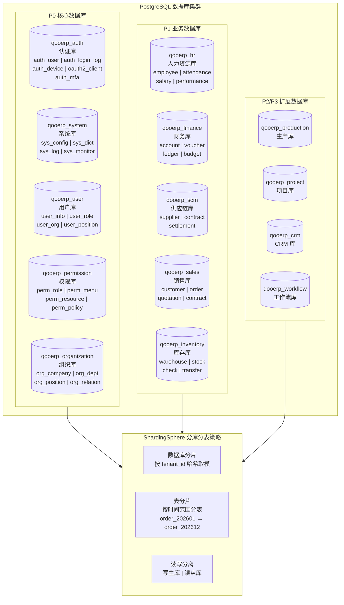

# QooERP 架构设计图

> 基于工程实际代码结构与规划文档生成
> 生成日期：2026-07-07

---

## 一、整体系统架构图

---

## 二、双模式部署架构图

---

## 三、微服务分层架构图（单服务内部）

---

## 四、数据架构图

---

## 五、认证授权流程架构图

---

## 六、前端 Monorepo 架构图

---

## 七、消息驱动架构图

---

## 八、网络部署架构图

---

## 九、数据库分库设计图

---

## 十、技术选型全景图

```mermaid
graph LR
    subgraph FrontendStack["前端技术栈"]
        F1["Vue 3.4+"]
        F2["TypeScript 5.3+"]
        F3["Vite 5"]
        F4["TDesign"]
        F5["Pinia"]
        F6["ECharts 5"]
        F7["Electron"]
        F8["Capacitor 5"]
    end

    subgraph BackendCore["后端核心框架"]
        B1["Spring Boot 3.3.6"]
        B2["Spring Cloud 2023.0.3"]
        B3["Spring Cloud Alibaba 2023.0.1.2"]
        B4["Spring Security 6"]
        B5["MyBatis Plus 3.5.7"]
        B6["Spring Data JPA 3"]
    end

    subgraph Middleware["中间件"]
        M1["Nacos 2.3"]
        M2["Sentinel 1.8.7"]
        M3["RocketMQ 5.3"]
        M4["Redis 7.2"]
        M5["Caffeine 3.1.8"]
        M6["ShardingSphere 5.5.1"]
        M7["Seata 2.0"]
        M8["Flyway 10"]
    end

    subgraph Storage["存储"]
        S1["PostgreSQL 15+"]
        S2["Elasticsearch 8.11+"]
        S3["MinIO"]
    end

    subgraph DevOps["DevOps 工具链"]
        D1["Docker 24"]
        D2["Kubernetes 1.28"]
        D3["Helm 3.13"]
        D4["Prometheus"]
        D5["Grafana"]
        D6["SkyWalking 9.7"]
        D7["ELK 8.11"]
        D8["GitHub Actions"]
    end

    FrontendStack --> BackendCore
    BackendCore --> Middleware
    Middleware --> Storage
    BackendCore --> DevOps
    Middleware --> DevOps
```

---

## 附录：各服务端口与状态汇总

| 序号 | 服务名称 | 端口 | 优先级 | 数据库 | 代码状态 | 设计文档 |
|------|----------|------|--------|--------|----------|----------|
| 1 | qooerp-gateway | 8000 | P0-A | 无 | ✅ 已完成 | ✅ |
| 2 | qooerp-auth | 8001 | P0-A | qooerp_auth | ✅ 已完成(94个Java文件) | ✅ |
| 3 | qooerp-system | 8082 | P0-B | qooerp_system | ✅ 已完成(68个Java文件) | ✅ |
| 4 | qooerp-permission | 8082 | P0-A | qooerp_permission | ✅ 已完成(75个Java文件) | ✅ |
| 5 | qooerp-user | 8084 | P0-C | qooerp_user | 🔶 仅启动类 | ✅ |
| 6 | qooerp-organization | 8085 | P0-C | qooerp_organization | ✅ 已完成(42个Java文件) | ✅ |
| 7 | qooerp-hr | - | P1 | qooerp_hr | ⬜ 规划中 | ✅ |
| 8 | qooerp-finance | - | P1 | qooerp_finance | ⬜ 规划中 | ✅ |
| 9 | qooerp-scm | - | P1 | qooerp_scm | ⬜ 规划中 | ⬜ |
| 10 | qooerp-sales | - | P1 | qooerp_sales | ⬜ 规划中 | ⬜ |
| 11 | qooerp-inventory | - | P1 | qooerp_inventory | ⬜ 规划中 | ⬜ |
| 12 | qooerp-purchase | - | P1 | qooerp_purchase | ⬜ 规划中 | ⬜ |
| 13 | qooerp-production | - | P2 | qooerp_production | ⬜ 规划中 | ⬜ |
| 14 | qooerp-project | - | P2 | qooerp_project | ⬜ 规划中 | ⬜ |
| 15 | qooerp-crm | - | P2 | qooerp_crm | ⬜ 规划中 | ⬜ |
| 16 | qooerp-workflow | - | P3 | qooerp_workflow | ⬜ 规划中 | ⬜ |
| 17 | qooerp-report | - | P3 | qooerp_report | ⬜ 规划中 | ⬜ |
| 18 | qooerp-file | - | P3 | qooerp_file | ⬜ 规划中 | ⬜ |
| 19 | qooerp-message | - | P3 | qooerp_message | ⬜ 规划中 | ⬜ |
| 20 | qooerp-notify | - | P3 | qooerp_notify | ⬜ 规划中 | ⬜ |
| 21 | qooerp-scheduler | - | P3 | qooerp_scheduler | ⬜ 规划中 | ⬜ |

> ✅ 已完成 | 🔶 部分完成 | ⬜ 未开始

---

*本文档使用 Mermaid 语法编写，可在支持 Mermaid 的 Markdown 编辑器（VS Code + Mermaid 插件、Typora、GitHub 等）中直接渲染为可视化图表。*
